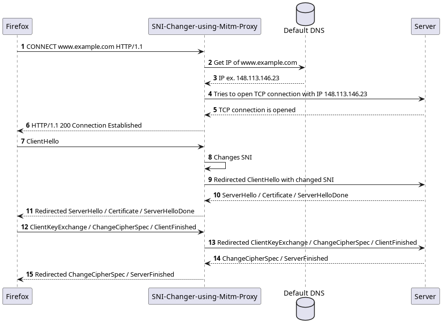

# SNI-Changer-using-Mitm-Proxy

## Overview

**SNI-Changer-using-Mitm-Proxy** is a tool that modifies the Server Name Indication (SNI) extension inside the TLS `ClientHello` message. It works by using a MITM proxy that intercepts the client's connection and returns a user-created root certificate to the client. The proxy then opens a separate TLS connection to the target server and changes the SNI extension in that `ClientHello`. Once both connections are established, the proxy forwards data between the client and the server, relaying traffic in both directions.



## What is the `ClientHello` message?

When a client (for example, a web browser) starts a secure HTTPS connection, it begins the TLS handshake by sending a `ClientHello` message. That message announces supported protocol versions, cipher suites, and other extensions (including SNI), essentially saying “hello, here’s what I support; let’s negotiate a secure session.”

## What is SNI?

The **Server Name Indication (SNI)** is an extension in the `ClientHello` that tells the server which hostname the client wants to connect to. This is important when a single server hosts multiple domains with different TLS certificates. Without SNI, the server can only present a single certificate (typically the default site). SNI allows the server to choose the appropriate certificate for the requested hostname during the handshake.

## Why change the SNI?

Modifying the SNI can be used to evade certain types of filtering and censorship. The paper [Efficiently Bypassing SNI-based HTTPS Filtering](https://dl.ifip.org/db/conf/im/im2015exp/137348.pdf) explores techniques that change or abuse the SNI to bypass firewalls and other SNI-based filters. Some approaches discussed include:

- **Bypassing based on backward compatibility:** exploiting how servers handle legacy or fallback behaviors, by removing the SNI.  
- **Bypassing based on shared server certificates:** using servers that present the same certificate for multiple hostnames to bypass filters.

## Traffic Redirection
There are several approaches to redirecting traffic towards the application. Currently, the forwarder must support the **CONNECT** message, which is sent prior to establishing the TLS connection, specifying the destination domain.

The application was designed to work with **Firefox**, but with the appropriate message sent initially, all functionalities should operate as intended with any tool.

Forwarders that have been tested:

- Firefox (using proxy settings).
- CURL (using the --proxy option).

## Usage
1. Clone the repository.
```shell
    $ git clone https://github.com/vicnetto/SNI-Changer-using-MitM-Proxy
    $ cd SNI-Changer-using-MitM-Proxy
```
2. Create the root certificate to sign each server certificate created by the application.
```shell
    $ make cert
    Enter DES3 password: (enter a password to the key)
```
> OBS: You can create your own rootCA and use it in the application. Therefore, this step is necessary only if you don’t have one.
3. Add the created root certificate to the forwarder (or to the system).
- In Firefox: `Settings -> Privacy and Security -> Certificates -> View Certificates -> Authorities -> Import…` -> Choose the cert/rootCA.pem from the source folder.
4. Make the application.
```shell
    $ make
```
5. Run the application.
```shell
    # In case you created your certificate with make cert.
    $ ./sni-changer-using-mitm-proxy cert/rootCA.pem cert/rootCA.key <key-password>
    # If you have independently generated your own certificate.
    $ ./sni-changer-using-mitm-proxy <root-ca-location> <root-key-location> <key-password>
```
6. Set the forwarder to the right port.
- In Firefox: `Setting -> General -> Network Settings -> Settings -> Manual Proxy Configuration`. In HTTPS Proxy, type: `localhost` and port `8080`.
7. **You’re good to go!** Next time, only **step 5 is necessary to run** the project.

## Credits
This tool was developed by Victor Netto, [Thibault Cholez](https://github.com/cholezth) and [Xavier Marchal](https://github.com/Nayald) of RESIST research group in [LORIA](https://www.loria.fr/fr/), France.
